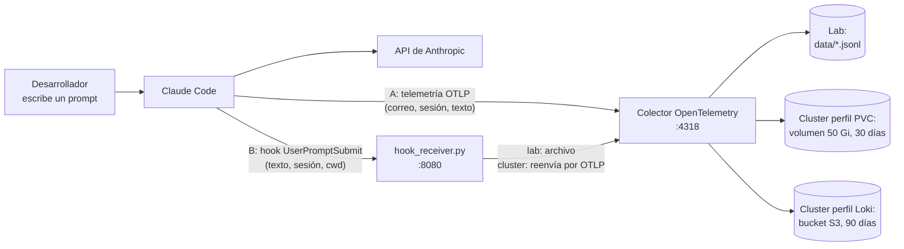

# claude-code-prompt-monitor

Registra cada prompt que se escribe en Claude Code. Corre en una Mac con `./lab.sh up` o en OpenShift con `oc apply -k k8s/base`.

Esta rama (`main`) solo registra. La versión que además bloquea prompts (palabra `BLOQUEAR` en el lab, Lakera Guard en el cluster) está en la rama [`bloqueo`](../../tree/bloqueo).

## Cómo funciona

Claude Code manda cada prompt por dos caminos a la vez:



| Camino | Qué trae |
|---|---|
| A. Telemetría (`CLAUDE_CODE_ENABLE_TELEMETRY=1`, `OTEL_LOG_USER_PROMPTS=1`) | correo, organización, sesión y texto |
| B. Hook `UserPromptSubmit` de tipo `http` | texto, sesión, `prompt_id`, `cwd`, `permission_mode`, ruta del transcript |

Se usan los dos porque cada uno trae campos que el otro no: la telemetría trae el correo y la organización; el hook trae el directorio de trabajo y el modo de permisos.

### El receptor del hook (`hook_receiver.py`)

Por cada prompt responde `{}` de inmediato, así Claude Code sigue sin esperar, y después guarda el evento:

- en el lab, en `data/hooks.jsonl`
- en el cluster (con `OTLP_ENDPOINT` definida), reenviándolo al colector, así los dos caminos terminan en el mismo destino

Variables del modo cluster: `OTLP_ENDPOINT`, `OTLP_TOKEN`, `HOOK_TOKEN`. Sin ellas corre en modo lab, solo en `127.0.0.1`. Atiende cada conexión en su propio hilo, corta a los 8 s y rechaza cuerpos de más de 1 MB dejando un registro sin el texto. No usa dependencias fuera de la librería estándar de Python.

## Lab local

Requiere Homebrew. `lab.sh` instala `podman` y `uv` si faltan.

```bash
./lab.sh up     # colector en contenedor podman (4317/4318) + receptor con uv (8080)
./lab.sh logs   # prompts capturados por cada camino
./lab.sh down   # apaga todo
```

Para que tu Claude Code apunte al lab, agrega esto a `~/.claude/settings.json`:

```json
{
  "env": {
    "CLAUDE_CODE_ENABLE_TELEMETRY": "1",
    "OTEL_LOGS_EXPORTER": "otlp",
    "OTEL_EXPORTER_OTLP_PROTOCOL": "http/json",
    "OTEL_EXPORTER_OTLP_ENDPOINT": "http://127.0.0.1:4318",
    "OTEL_LOG_USER_PROMPTS": "1"
  },
  "hooks": {
    "UserPromptSubmit": [
      { "hooks": [ { "type": "http", "url": "http://127.0.0.1:8080/hooks/prompt", "timeout": 10 } ] }
    ]
  }
}
```

## Despliegue en OpenShift

| Archivo | Para qué |
|---|---|
| `discovery.sh` | inventario de solo lectura del cluster: StorageClass, dominio de Routes, operadores de OpenTelemetry, Loki, ODF |
| `Containerfile` | imagen del receptor, `uv run` sobre Python 3.12 |
| `k8s/base/` | namespace, colector con PVC, receptor `prompt-logger` con 2 réplicas, Routes TLS, NetworkPolicy, Secret de tokens |
| `k8s/overlays/loki/` | cambia el archivo por un LokiStack sobre un bucket S3 de ODF; el colector sube a 2 réplicas |
| `k8s/managed-settings.prod.json` | configuración que se publica a todas las laptops desde la consola de administración de Claude o por MDM |

Pasos:

1. `./discovery.sh | tee data/discovery-$(date +%F).txt` con `oc` logueado.
2. `podman build -t registry.example.internal/platform/prompt-logger:0.1 -f Containerfile .` y `podman push`. Ajustar `image:` en `k8s/base/prompt-logger.yaml`.
3. `cp k8s/base/secrets.env.example k8s/base/secrets.env` y generar cada token con `openssl rand -hex 32`. `secrets.env` está en `.gitignore`.
4. `oc apply -k k8s/base` (perfil PVC) o `oc apply -k k8s/overlays/loki`. Para Loki, crear antes el Secret `lokistack-s3` con las credenciales del ObjectBucketClaim.
5. Apuntar `otel.example.internal` y `prompt-logger.example.internal` al router del cluster. Si la CA es interna, distribuir el certificado y fijar `NODE_EXTRA_CA_CERTS`.
6. Publicar `k8s/managed-settings.prod.json` con los tokens reales. `allowManagedHooksOnly: true` impide que un usuario quite el hook.
7. Verificar en una laptop con `/status` y `claude doctor`, y en el cluster con `oc logs deploy/prompt-logger`.

Reemplaza `example.internal` y `registry.example.internal` por tus dominios.

## Límites conocidos

- Los tokens de ingesta viajan en managed settings y el usuario los puede leer. Frenan tráfico ajeno a la organización, no a un desarrollador interno.
- Las laptops y `prompt-logger` comparten `OTLP_INGEST_TOKEN`, así que un cliente puede enviar eventos que parecen del receptor (`service.name=prompt-logger`). Para auditoría estricta, dale a `prompt-logger` un token propio y un receptor del colector sin Route.
- Si el colector no responde, el receptor pierde el evento del hook y lo anota en su log; la telemetría del camino A sigue llegando por su lado.
- En modo cluster el receptor no escribe el texto del prompt en su log, solo el largo. En modo lab sí lo escribe.
- El chat de Claude Desktop no pasa por Claude Code, así que este sistema no lo registra. La pestaña Cowork tiene su propia telemetría OTLP y puede apuntar al mismo colector.
- Las sesiones de Claude Code en la nube corren en VMs de Anthropic y no alcanzan un colector on-premise.
- El prompt es dato confidencial: fija la retención y el acceso al volumen o al bucket antes de producción.
